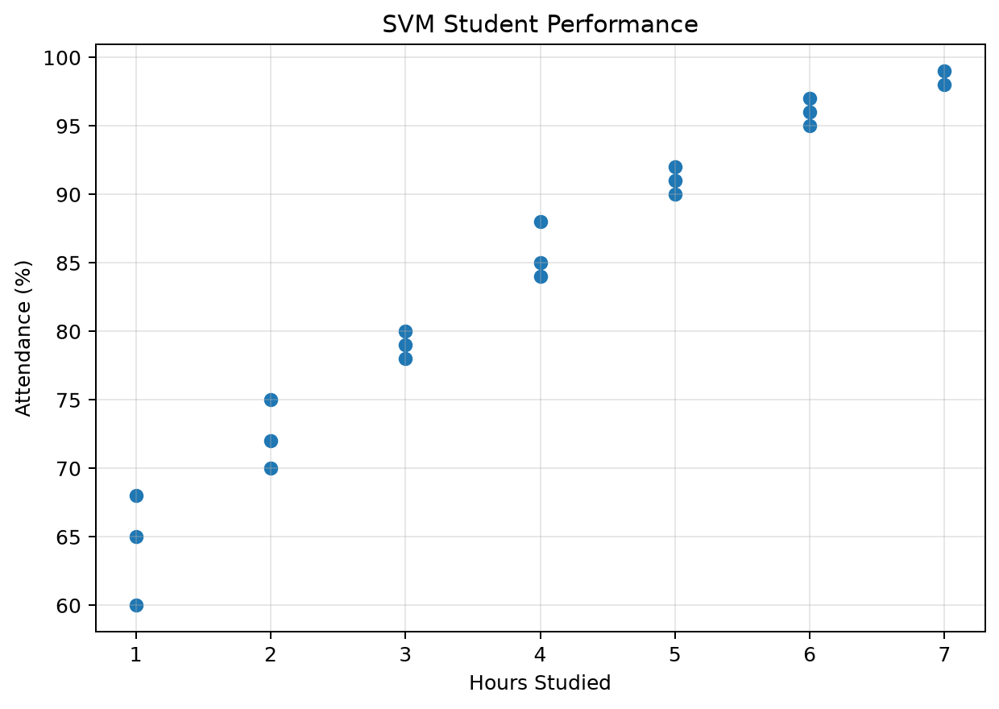

# 6. SVM Classification

[Back to experiments](../README.md)

[Python source](svm_classification.py) | [Dataset](data.csv) | [Text output](output.txt)

## Code

```python
import pandas as pd
import matplotlib.pyplot as plt

from sklearn.model_selection import train_test_split
from sklearn.svm import SVC
from sklearn.metrics import (
    accuracy_score,
    confusion_matrix,
    classification_report
)

# Load dataset
data = pd.read_csv("data.csv")

# Input features
X = data[['Hours_Studied', 'Attendance', 'Assignments']]

# Target variable
y = data['Result']

# Split dataset
X_train, X_test, y_train, y_test = train_test_split(
    X, y, test_size=0.2, random_state=42
)

# Create SVM model
model = SVC(kernel='linear')

# Train model
model.fit(X_train, y_train)

# Predict
y_pred = model.predict(X_test)

# Evaluation Metrics
accuracy = accuracy_score(y_test, y_pred)

print("Accuracy:", accuracy)

print("\nConfusion Matrix:")
cm = confusion_matrix(y_test, y_pred)
print(cm)

print("\nClassification Report:")
print(classification_report(y_test, y_pred))
# Plot the student data used by this experiment.
plt.figure(figsize=(7, 5))
plt.scatter(data['Hours_Studied'], data['Attendance'])
plt.xlabel('Hours Studied')
plt.ylabel('Attendance (%)')
plt.title('SVM Student Performance')
plt.grid(True, alpha=0.3)
plt.tight_layout()
plt.savefig('svm_student_performance.png', dpi=180, bbox_inches='tight')
plt.close()
```

## Output

```text
Accuracy: 1.0

Confusion Matrix:
[[2 0]
 [0 2]]

Classification Report:
              precision    recall  f1-score   support

        Fail       1.00      1.00      1.00         2
        Pass       1.00      1.00      1.00         2

    accuracy                           1.00         4
   macro avg       1.00      1.00      1.00         4
weighted avg       1.00      1.00      1.00         4
```

## Graph



Each dot represents a student. This scatter plot shows the relationship between hours studied and attendance in the experiment dataset.

## Run

From this experiment folder, run `python svm_classification.py`. The PNG is saved in the same folder.
