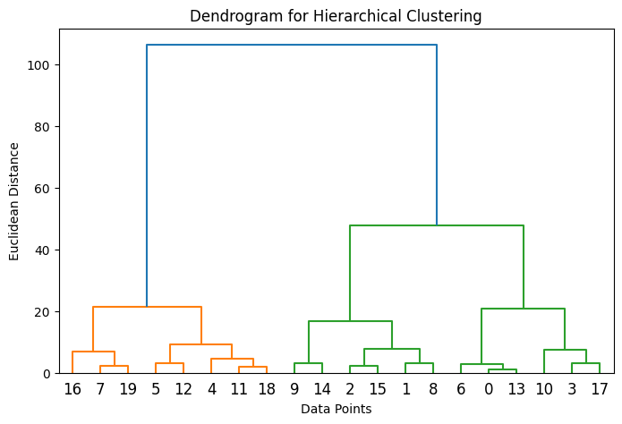
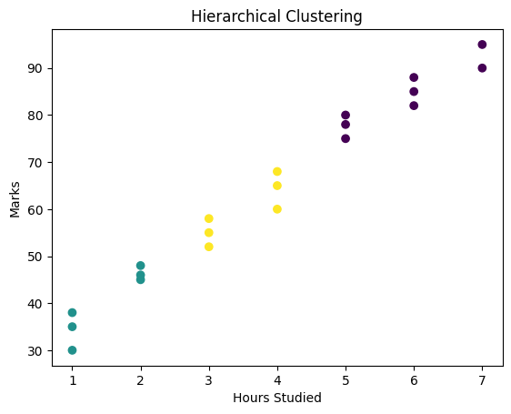

# 8. Hierarchical Clustering

[Back to experiments](../README.md)

[Python source](hierarchical_clustering.py) | [Dataset](data.csv) | [Text output](output.txt)

## Code

```python
import pandas as pd
import matplotlib.pyplot as plt
from scipy.cluster.hierarchy import dendrogram, linkage
from sklearn.cluster import AgglomerativeClustering
# Load dataset
data = pd.read_csv("data.csv")
# Select features
X = data[['Hours_Studied','Marks']]
# Create linkage matrix
linked = linkage(X,method='ward')
# Plot Dendrogram
plt.figure(figsize=(8, 5))
dendrogram(linked)
plt.title("Dendrogram for Hierarchical Clustering")
plt.xlabel("Data Points")
plt.ylabel("Euclidean Distance")
plt.show()
# Apply Hierarchical Clustering
hc = AgglomerativeClustering(n_clusters=3)
clusters = hc.fit_predict(X)
# Add cluster labels to dataset
data['Cluster'] = clusters
print(data)
# Scatter Plot
plt.scatter(X['Hours_Studied'], X['Marks'], c=clusters)
plt.xlabel("Hours Studied")
plt.ylabel("Marks")
plt.title("Hierarchical Clustering")
plt.show()
```

## Output

```text
    StudentID  Hours_Studied  Attendance  Assignments  Marks Result  Cluster
0           1              2          75            3     45   Fail        1
1           2              3          80            4     52   Pass        2
2           3              4          85            5     60   Pass        2
3           4              1          65            2     35   Fail        1
4           5              5          90            5     75   Pass        0
5           6              6          95            5     82   Pass        0
6           7              2          70            3     48   Fail        1
7           8              7          98            5     90   Pass        0
8           9              3          78            4     55   Pass        2
9          10              4          88            4     68   Pass        2
10         11              1          60            2     30   Fail        1
11         12              5          92            5     80   Pass        0
12         13              6          96            5     85   Pass        0
13         14              2          72            3     46   Fail        1
14         15              4          84            4     65   Pass        2
15         16              3          79            4     58   Pass        2
16         17              7          99            5     95   Pass        0
17         18              1          68            2     38   Fail        1
18         19              5          91            5     78   Pass        0
19         20              6          97            5     88   Pass        0
```

## Graphs






## Run

From this experiment folder, run: `python hierarchical_clustering.py`.

